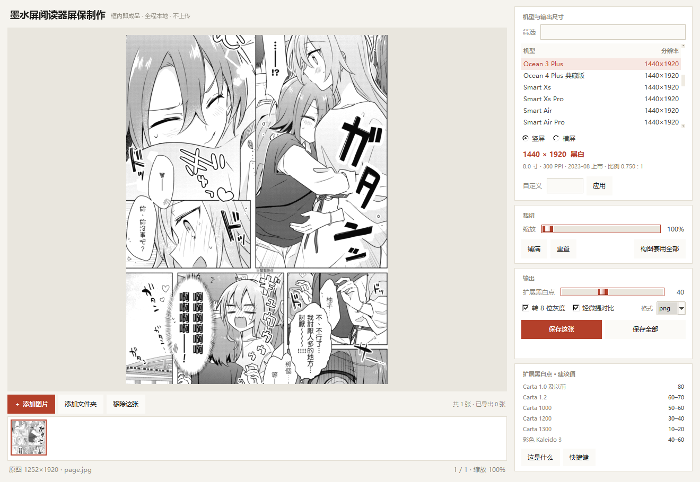

<div align="center">
  <h1>墨水屏阅读器屏保制作</h1>
  <p><b>按机型原生分辨率把图裁成墨水屏屏保，让阅读器不必再插手缩放</b></p>
  <p>
    
    
    
  </p>
</div>

给电子墨水屏阅读器批量做锁屏屏保的桌面工具：按机型原生分辨率裁切、转 8 位灰度、扩展黑白点，一键导出 PNG。

单文件 EXE，不装 Python、不联网、不上传，复制到 U 盘就能用。

**[下载最新版](https://github.com/yesloli/eink-screensaver-maker/releases/latest)** ·
双击即用，无需安装；首次运行如遇 SmartScreen 提示，选「更多信息 → 仍要运行」
（单文件 EXE 未做代码签名，属正常现象）。



## 为什么做这个

墨水屏做屏保有几个绕不过去的坑，市面上的裁剪工具基本都不管：

- **必须点对点**。图片一旦被设备二次缩放，线条就出锯齿、抖动网纹被糊成噪点。
- **只有 16 级灰阶**。面板是 4 bit（Carta 全系，包括 Carta 1300 的官方规格页至今仍写 *16 Gray Level*），
  所谓"256 级灰阶"是设备端用算法抖动模拟出来的。所以图能提供的有效层次其实很有限。
- **图大多没跑满 0–255**。相机直出、扫描件、网图常见暗部停在 20、高光只到 235，
  等于把 16 级用成了 13 级。

这个工具就是围绕这三点做的。

## 功能

- **机型库**：54 条掌阅 iReader 机型（2015 初代 → 2026 Ocean 6 / Air 3 Pro），带筛选；
  也支持自定义像素。每台机器提供竖屏 / 横屏两种输出（面板物理竖屏，厂商标称常写横向）。
- **预览框严格等于输出比例**：换机型、缩放窗口，框的比例始终跟输出一致，不会再被拉伸。
- **逐图独立构图**：每张图的缩放与位置各自记住；「构图套用全部」可把当前构图复制给同系列所有图。
- **扩展黑白点 0–100**：把每张图自己的黑/白点（按直方图，两端各裁 0.5%）线性铺到 0–255，
  让面板那 16 级灰阶全部用上。见下节。
- **导出**：8 位灰度 PNG（或 JPG），可选轻微提对比，支持批量 + 进度条。
- 拖拽 / 滚轮缩放 / 方向键微调 / A、D 切图 / Delete 移除。

## 扩展黑白点怎么调

滑块独立存在，不跟机型绑定。**0 = 完全不动，100 = 拉满**，中间是插值。
黑点白点按每张图各自计算，不是全局统一参数——批量导出时每张图会各自适配。

各代面板的建议值（面板对比度越低，白态越灰、16 级之间本就越挤，所以越浪费不起）：

| 面板 | 对比度 | 建议 |
|---|---|---|
| Carta 1.0 及以前（Pearl / 早期） | 10–15:1 | **80** |
| Carta 1.2 | 15:1 | **60–70** |
| Carta 1000 | 15:1 级（1200 的基准） | **50–60** |
| Carta 1200 | ≈17:1 | **30–40** |
| Carta 1300 | ≈20:1 | **10–20** |
| 彩色 Kaleido 3 | 彩膜拉低反射率 | **40–60** |

两个提醒：

- 拉得越狠，16 级之间每级跳变越大。设备的 256 级抖动如果是关着的，会出现更明显的色带，别盲拉。
- 它不会凭空增加对比度，只是把图里已有的范围铺开。已经调过对比的图，拉满也几乎看不出变化。

## 机型库数据来源

按可信度排序：

1. **掌阅官方新闻稿 / 官方参数**：Ocean 3 Plus、Smart Xs、Smart 2、Ocean 6 系列等，一手数据直接采信。
2. **readwithpro.com 的 iReader 品牌档案**：收录 62 台可比较机型，逐台标注面板、分辨率、PPI，
   并区分「官方标注」与「按分辨率推算」。本库多数条目来自这里。
3. **太平洋电脑网 / 中关村在线**：仅作交叉验证。

后两家有明显笔误（把 6 寸的 C6 写成 1872×1404、把 Smart 3 写成 1404×872、把 Light 2 Pro 写成 330PPI），
凡与 PPI 数学不自洽的一律未采用。校验方法：`分辨率 ÷ PPI` 两轴勾股后应等于标称对角尺寸，
例如 1264÷300=4.21″、1680÷300=5.60″，√(4.21²+5.60²)=7.00″ ✓。

已知存疑两处（保留主流标称值）：

- **Tango 系列** 6.13 寸 1648×842（2:1 长条，手机形态），来源一致但比例少见。
- **Smart 5** 1874×1404（比同代多 2px，疑标称笔误），若导出有 1–2px 白线改成 1872×1404。

## 从源码运行 / 打包

需要 Python 3.9+、Pillow；拖放功能依赖 tkinterdnd2（没装也能跑，只是拖拽失效）。

```bash
pip install -r requirements.txt
python crop_studio.py
```

打包单文件 EXE（Windows）：

```bash
pip install -r requirements-dev.txt
pyinstaller --noconfirm --clean crop_studio.spec
```

产物 `dist\墨水屏阅读器屏保制作.exe`（约 20 MB）。发布用的文件名另存一份纯 ASCII 的
`eink-screensaver-maker-<tag>-windows-x64.exe`——GitHub Release 处理非 ASCII 附件名时
会丢掉原名，实测中文名会变成 `default.exe`。

### 自检

```bash
python crop_studio.py --selftest selftest.txt   # 无窗口，退出码 0 表示通过
python crop_studio.py --version
```

自检会真的渲染几张不同比例的测试图：cover 构图 → LANCZOS 重采样 → 8 位灰度 →
查找表 → PNG 落盘 → 回读逐像素比对，并校验机型库「分辨率 ÷ PPI」是否落在
真实面板档位上。CI 每次推送都跑，打包后还会用 EXE 本身再跑一遍。

## 目录结构

```
crop_studio.py      主程序（tkinter + Pillow）
models.py           机型库（54 条）与数据来源说明
crop_studio.spec    PyInstaller 打包配置
make_icon.py        生成 app.ico
_smoke.py           开发期冒烟测试：起窗口 → 置顶 → 截自身区域 → 退出
app.ico             图标
docs/screenshot.png
legacy/crop-tool.html   最早的单页网页版，功能与桌面版一致但只能手动逐张裁
.github/workflows/build.yml   CI：推送跑自检，打 tag 自动打包发 Release
```

## 其他

- 设置存在 exe 同目录 `screen-maker.json`；目录不可写时退回 `%APPDATA%\EinkScreenMaker\settings.json`。
- 机型数据全部来自公开资料，型号名称归掌阅 iReader 所有；本工具与掌阅无隶属关系。
- 导出的是无损 PNG。不要用 JPEG 存档：高对比边缘的振铃会污染设备端的抖动图案。
- 许可证 [MIT](LICENSE)。
